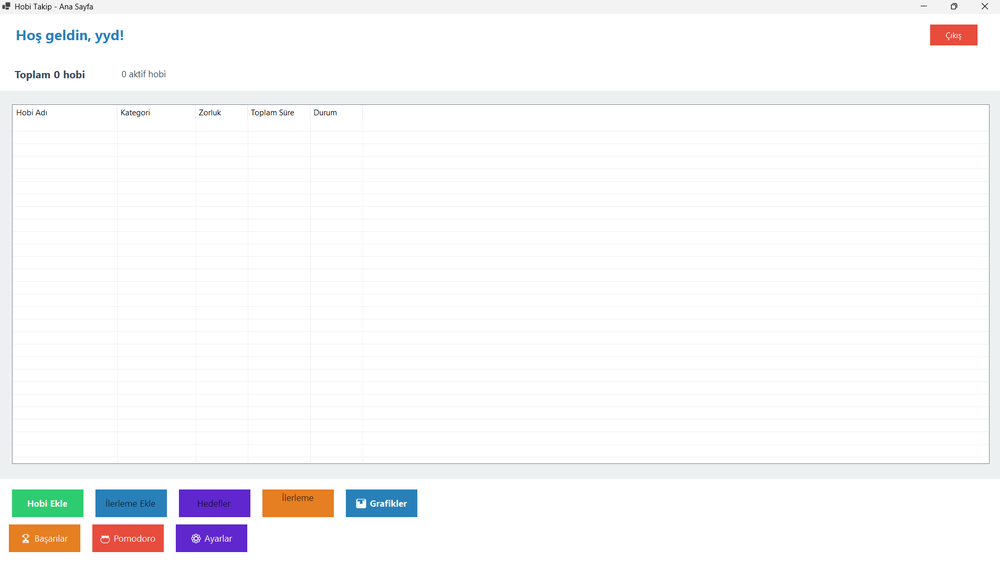
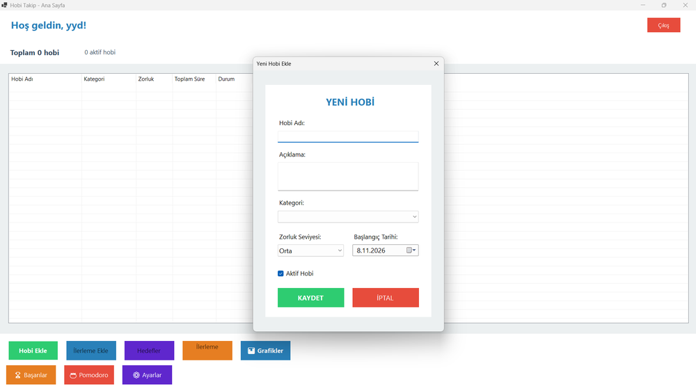
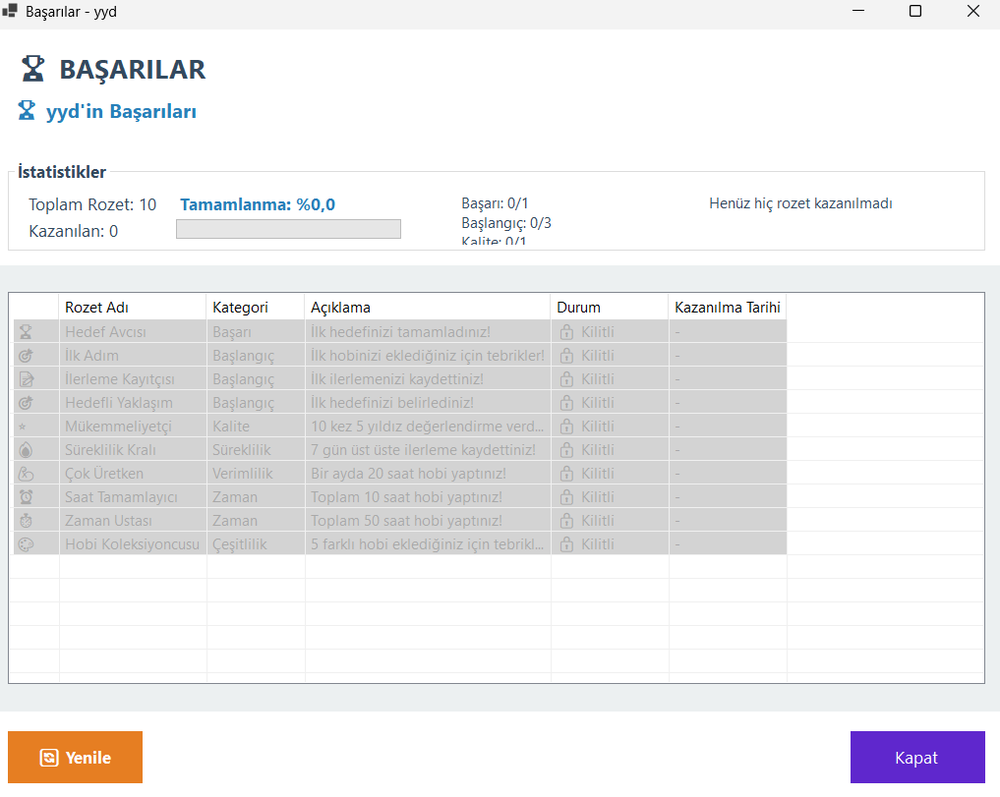
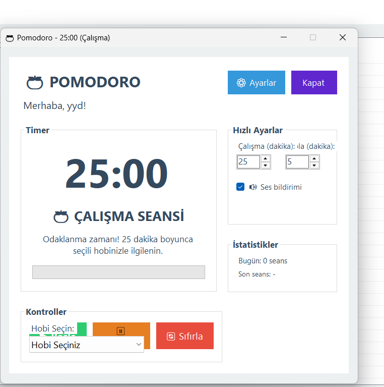
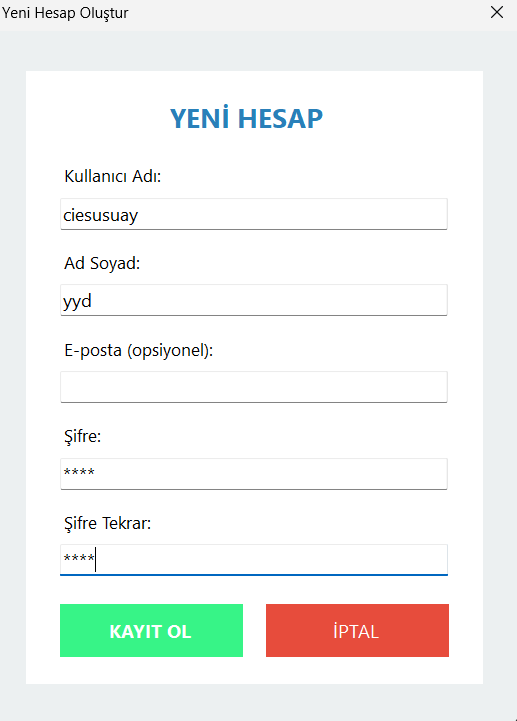

# HobiTakip — Hobby Tracker

A Windows desktop app for keeping track of hobbies, the goals you set for them and the time you actually spend. Everything is stored in a local SQLite file, so it works without internet and without an account on any server.

## Features
- **Accounts:** register and log in, each user has their own data (passwords are hashed)
- **Hobbies:** add hobbies with categories, difficulty level and active/passive status
- **Goals:** measurable goals with target dates and progress percentage
- **Progress log:** daily activity entries with time spent, a 1–5 satisfaction rating and notes
- **Charts:** hobby time distribution, monthly trend, weekly activity, ratings, goal completion and time by category
- **Achievements:** badges unlocked automatically (first hobby, 10 hours, 7-day streak and more)
- **Pomodoro timer:** 25/5 minute sessions that log time to a chosen hobby automatically
- **Themes:** light, dark and system theme
- **Notifications and data export**

## Screenshots

The app's interface is in Turkish. English names are in brackets.

| Main screen (*Ana Sayfa*) | Add a hobby (*Hobi Ekle*) |
|---|---|
|  |  |

| Achievements (*Başarılar*) | Pomodoro timer | Create account (*Yeni Hesap*) |
|---|---|---|
|  |  |  |

## First steps (no experience needed)

1. Start the app and open the register form from the login screen. Enter a user name, your name and a password, then press **KAYIT OL**. E-mail is optional.
2. Log in with the same user name and password. You land on the main screen, which is empty at first.
3. Click **Hobi Ekle** (Add hobby). Type a name, pick a category and a difficulty, then press **KAYDET** (Save). Your hobby appears in the list.
4. Click **İlerleme Ekle** (Add progress) after you practise: choose the hobby, enter the minutes spent and a 1-5 rating.
5. Click **Hedefler** (Goals) to set a measurable goal with a target date.
6. Click **Pomodoro**, choose a hobby and start the timer. When a session ends, the time is added to that hobby.
7. Click **Başarılar** (Achievements) to see your badges; they unlock automatically. **Grafikler** (Charts) shows your statistics. **Ayarlar** (Settings) changes the theme.

## Technology and infrastructure

| Part | What it uses | Notes |
|---|---|---|
| Language | C# on .NET 9 | The project targets `net9.0-windows`. |
| Interface | Windows Forms | Windows only. |
| Database | SQLite | A single local file, created the first time you start the app. The packages are `Microsoft.Data.Sqlite` 8.0.0 and `System.Data.SQLite.Core` 1.0.118. |
| Charts | `System.Windows.Forms.DataVisualization` | A prerelease package (1.0.0-prerelease.20110.1). See Troubleshooting if the Charts screen fails. |
| Passwords | SHA-256 with a fixed salt | Fine for learning, not for production. See Known limitations. |
| Installer | Visual Studio installer project | In the `HobiTakipSetup` folder. |
| Server | None | No network calls, no cloud. |

## Run it
1. Install Visual Studio with the **.NET desktop development** workload and the .NET 9 SDK.
2. Open `HobiTakip.sln` and run the `HobiTakip` project.
3. The SQLite database is created automatically on first launch.

More details (in Turkish) are in `HobiTakip/README.md`, `HobiTakip/KURULUM_REHBERI.md` and `HobiTakip/YENI_OZELLIKLER.md`.

## Troubleshooting

- **The solution does not open or build:** install Visual Studio 2022 (or newer) with the ".NET desktop development" workload and the .NET 9 SDK, then reopen `HobiTakip.sln`.
- **"Could not load file or assembly 'System.Data.SqlClient'" on the Charts screen:** the chart control needs this assembly. In Visual Studio open *Tools > NuGet Package Manager > Package Manager Console* and run `Install-Package System.Data.SqlClient -Project HobiTakip`, then rebuild. More notes: `HobiTakip/CHART_SORUN_GIDERME.md`.
- **Where is my data?** In a local SQLite file created on first launch. Delete that file to start from scratch.

## Known limitations
Password hashing uses SHA-256 with a fixed salt, which is fine for a learning project. A production app should use a per-user salt with bcrypt or Argon2.

## Author
Yusuf Yahya Değirmenci — [GitHub](https://github.com/yusufydegirmenci) · [LinkedIn](https://www.linkedin.com/in/yusufydegirmenci/)
